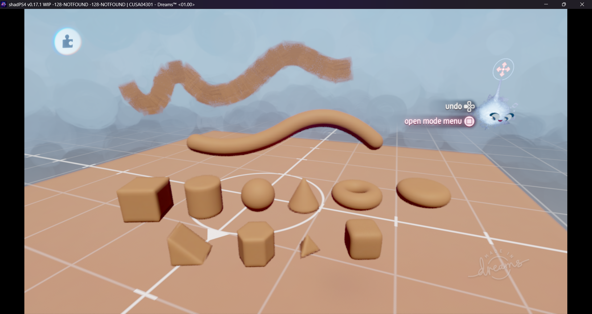
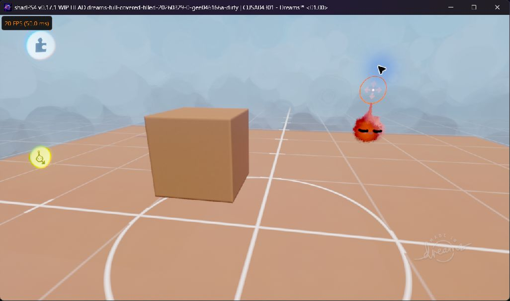
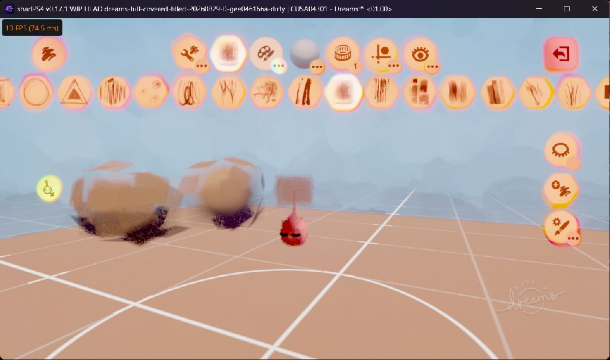

# Dreams on shadPS4

Updated **October 19, 2026**. This repository contains experimental shadPS4 fixes and tested builds for Dreams (`CUSA04301`).

October 15 screenshot: sculpt shapes and paint in Dreams running on shadPS4.

## Latest tested build

**[Download the October 19 shader-instruction update (ZIP)](https://github.com/JesusDaBest/Dreams-ShadPS4/raw/refs/heads/main/builds/cusa04301-shader-instructions-20261019/Dreams-shader-instructions-20261019.zip)**

This is the exact executable currently played by the owner (`640a3ba8`). Extract and double-click **Launch-Dreams.cmd**, then enter your Dreams eboot.bin path. The tested settings are applied automatically.

Corrects shader bit-field extraction, carry/borrow/overflow and floating-point class handling. Includes retained branch updates and the cumulative source patch. Saved instruction tests passed; cube and kitchen live checks are recorded. Performance gains and every scene remain unverified. [Changes, source, tests and limitations](SHADER_INSTRUCTIONS_BUILD_20261019.md).

Previous October 17 checkpoint:

**[Download the October 17 ordered-count update (ZIP)](https://github.com/JesusDaBest/Dreams-ShadPS4/raw/refs/heads/main/builds/cusa04301-ordered-count-20261017/Dreams-ordered-count-20261017.zip)**

This is the preceding October 17 executable (`966d8fbe`). Extract and double-click **Launch-Dreams.cmd**, then enter your Dreams eboot.bin path. The required settings are enabled automatically. It retains this branch's preceding shape, performance and occlusion fixes.

Adds ordered-count handling for six additional Dreams shaders alongside scene-compaction and selection-list handling. Saved synthetic GPU validation passed 108 cases with no Vulkan validation errors; the owner confirmed improved visuals were retained. Performance observations are not a controlled benchmark. [Changes, matching source, tests and limitations](ORDERED_COUNT_BUILD_20261017.md).

Previous October 16 occlusion checkpoint:

**[Download the current occlusion rendering fix (ZIP)](https://github.com/JesusDaBest/Dreams-ShadPS4/raw/refs/heads/main/builds/cusa04301-occlusion-fix-20261016/Dreams-occlusion-fix-20261016.zip)**

This is the preceding occlusion checkpoint. Extract and run **Launch-Dreams.cmd**, then enter your Dreams eboot.bin path. It retains the preceding October 16 performance/shape fixes and launch profile. No extra activation switch is needed for this correction.

The owner confirmed the tested scene's corner corruption was gone. The fix preserves the requested mip when Dreams samples a plain 2D occlusion map with array-style coordinates. Other scenes and performance impact remain unmeasured; a bound-view mip-limit uncertainty remains documented. [Fix, findings, tests and matching source](OCCLUSION_FIX_20261016.md).

Previous October 16 performance checkpoint:

**[Download the previous October 16 performance build (ZIP)](https://github.com/JesusDaBest/Dreams-ShadPS4/raw/refs/heads/main/builds/cusa04301-performance-20261016/Dreams-performance-20261016.zip)**

This is the preceding performance EXE, with its tested launch profile. Extract and run **Launch-Dreams.cmd**, then enter your Dreams eboot.bin path. The launcher backs up the existing per-game configuration before applying the tested settings. Requires your existing game/system setup and the Microsoft Visual C++ x64 runtime.

Retains the October 15 shape correction and adds the retained loading/readback/queue changes and pooled tiling allocations. The owner reports substantially improved performance; existing visual bugs remain. This does not merge the separate October 6 branch. [Changes, source and validation](PERFORMANCE_BUILD_20261016.md).

Previous October 15 checkpoint:

**[Download shadps4.exe — October 15 shape rendering fix](https://github.com/JesusDaBest/Dreams-ShadPS4/raw/refs/heads/main/builds/cusa04301-shape-density-fix-20261015/shadps4.exe)**

The saved cube, cylinder and vertically stretched sphere rendered correctly in the user's test
scene. The correction is enabled automatically. Use your existing launcher/runtime dependencies
with **Precise GPU readbacks**, **pipeline caching disabled** and **shader patching disabled**.
[Fix, test scope and source](SHAPE_DENSITY_FIX_20261015.md).

This build uses the older Dreams ordered-count implementation. It is a different source branch
from the October 6 tweak-menu build; it does not include that branch's combined changes.

Previous October 6 checkpoint:

**[Download updated shadps4.exe — October 6 tweak-menu fix](https://github.com/JesusDaBest/Dreams-ShadPS4/raw/refs/heads/main/builds/cusa04301-tweak-menu-blur-fix-20261006/shadps4.exe)**

The tweak-menu fix is enabled automatically. Use this EXE with your existing launcher/runtime dependencies and Precise GPU readbacks. [Fix and validation](TWEAK_MENU_BLUR_FIX_20261006.md).

Previous October 4 checkpoint:

**[Download shadps4.exe — October 4 selector reset and paint rendering fix](https://github.com/JesusDaBest/Dreams-ShadPS4/raw/refs/heads/main/builds/cusa04301-selector-reset-fix-20261004/shadps4.exe)**

Use the executable with your existing launcher/runtime dependencies and **Precise GPU readbacks**. Diagnostic environment flags should be unset. This download is the exact diagnostic executable tested locally, rather than a complete portable runtime package.

## Confirmed improvements

- **Shape tables (October 15 build):** shader-relative inline-table relocation corrected the saved
  cube, cylinder and vertically stretched sphere in the tested scene. [Fix and validation](SHAPE_DENSITY_FIX_20261015.md).

The older results below belong to their linked checkpoints; inclusion in the October 15 branch
is not implied for every item.

- **Tweak-menu blur:** selected-mip coordinate correction passed close, normal and far tests for the tested menu. [Fix and validation](TWEAK_MENU_BLUR_FIX_20261006.md).

- **Selector reset and paint rendering:** the severe pause/unpause lag stopped in the tested scene, selector IDs are now valid, and the user confirmed paint strokes render. [Fix and validation](SELECTOR_RESET_FIX_20261004.md).

- **Cube shading:** the cube now looks like an actual cube. Fixing zero-offset alignment instructions removed the tiled seams from the live cube and floor normals. [Fix and before/after evidence](SCULPT_ALIGNMENT_FIX_20261004.md).
- **Imp trails and tweak-menu smush:** persistent imp copies in menus and the tweak-menu smush were removed on the tested system. This fix is included in the new executable. [Validation record](IMP_SMUSH_FIX_20261004.md).
- **Scene save IDs:** three test scenes kept distinct version IDs, contents, and previews; discarding a fourth preserved all three. [Validation record](SAVE_ID_FIX_20261003.md).

## Earlier October 4 in-game screenshot

Captured directly from Dreams running the October 4 alignment-fix executable. The cube now renders with clean faces. This image shows the game itself; the separate GPU-normal comparison is in the [validation record](SCULPT_ALIGNMENT_FIX_20261004.md).

## New selector reset / paint-mode screenshot

Actual Dreams after the new fix, with paint tools open. Paint strokes now render according to the user; sculpt surface defects remain visible. The previous cube screenshot above is retained.

## Remaining work

- Expand the October 15 shape fix tests beyond the saved cube, cylinder and stretched sphere, including more complex sculpts and editing operations.
- Investigate sculpt-limit warnings, remaining low frame rates and other editing slowdowns. The demonstrated pause/unpause workload explosion is corrected locally.
- Verify the new tweak-menu blur correction across other menus, GPUs and versions; other missing content may remain.
- Verify other GPUs and game versions. A separate user's imp trails remain unresolved.

The successful local test used an **AMD Radeon 8060S**, **CUSA04301 VERSION 02.64** (APP_VER 01.00), and Precise readbacks. Version 02.65 and complete game compatibility are not verified. The cube improvement does not establish that all sculpt rendering or gameplay is fixed.

## Source and records

- [October 15 shape fix and validation](SHAPE_DENSITY_FIX_20261015.md)
- [Focused shape-table patch](patches/dreams-shape-density-inline-tables-20261015.patch)
- [Matching October 15 source delta](patches/dreams-source-delta-20261015-shape-density.patch)

- [Selector reset fix and validation](SELECTOR_RESET_FIX_20261004.md)
- [Focused selector reset patch](patches/dreams-selector-reset-fix-20261004.patch)
- [October 4 cumulative main-source snapshot](patches/dreams-diagnostic-source-20261004-selector-reset.patch)

- [Source build instructions](SOURCE_BUILD.md)
- [Focused alignment patch](patches/generic-align-zero-offset-fix-20261004.patch)
- [Cumulative main-source diagnostic patch](patches/dreams-diagnostic-source-20261004-sculpt-alignment.patch)
- [Current status](STATUS.md) and [remaining issues](ISSUES.md)
- [August/September investigation archive](HISTORICAL_README_20260907.md)
- [Historical August 29 build](builds/cusa04301-full-covered-filled-20260829) and [earlier October 4 imp/smush build](builds/cusa04301-imp-smush-cache-fix-20261004)

This repository contains no game files, firmware, keys, PSN credentials, or user saves. The emulator builds are experimental.
